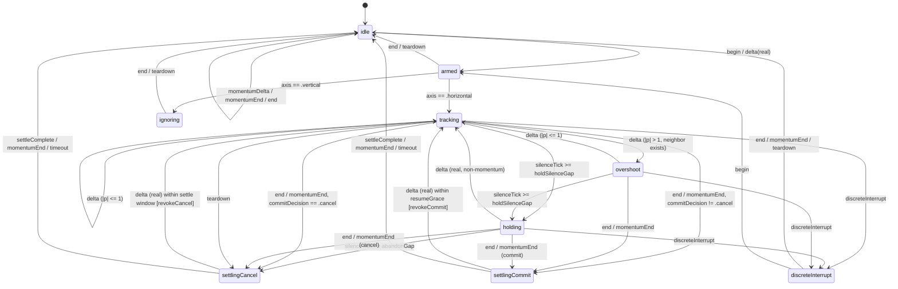

# Swipe Core Redesign

Design doc for rebuilding the workspace swipe/switch **gesture policy core** as an explicit, pure, unit-testable state machine. The rendering layer (`SlideOffsetLayer`, preview twins, C++ backdrop push, arbiter routing) is preserved.

## 1. What the evidence already settled (not re-litigated)

| Finding | Source | Consequence for this design |
|---|---|---|
| Trackpad emits **nothing** during a slow creep with fingers down; 10/10 watchdog fires preceded by exactly 1.0s of LP1 silence | Live capture 2026-07-28 | Silence is never gesture-over. `holding` is a first-class state; the watchdog must HOLD, never settle. |
| Force-settle at silence commits when progress > 0.15, rolls back below | Live capture | The "freeze then jump" is a *policy* bug, not a pipeline bug. |
| Momentum deltas are deliberately swallowed after a real `.ended` | Momentum investigation verdict | Momentum never drives progress or the commit decision. Release velocity is the only inertia source. |
| Synthetic flicks reach 7.5-8.8 progress/s only at dx=-450; real-hand velocities are unmeasured | Flick velocity measurement | Velocity-hardened settle stays as shipped; this redesign does not retune it. |
| `.swallowingMomentum` is unrecoverable by `.changed` | Swallow-state investigation | Settling states must accept a real (non-momentum) delta as evidence the end was spurious. |
| ~8 catcher instances see every event, 7 discard | Catcher count audit | One owner per window. |
| Both panes composite misaligned mid-slide | Compositing audit | Pane geometry must be pinned, not emergent. |

## 2. State machine



`begin` always wins from any state (a genuine new gesture is never swallowed - preserves the rapid-double-swipe property).

## 3. State / transition table with invariants

| State | Meaning | Accepts | Rejects | Invariants |
|---|---|---|---|---|
| `idle` | no gesture | `begin`, real `delta` (implicit begin - covers a dropped `.began`, the "phase hiccup" case) | `momentumDelta`, `momentumEnd`, `end` | no session open; progress not emitted |
| `armed` | axis undecided, deltas accumulating | `delta` | - | **no `beginSession` emitted yet**: a vertical scroll never enters the slide layer |
| `ignoring` | axis locked vertical | `delta` (discarded) | - | absorbing for the gesture's life; progress pinned 0; can never commit |
| `tracking` | fingers down, 1:1 | `delta`, `momentumDelta`(ignored), `end`, `silenceTick` | - | `progress == -accumX/width` exactly (contract 1); no timer may leave this state toward a commit |
| `holding` | fingers down, event stream silent | real `delta` (-> `tracking`, **accumulator NOT reset**), `end`, `momentumEnd`, `silenceTick` | `momentumDelta` | progress frozen at its last value; velocity EMA decays to ~0; **no commit is reachable from a timer** (contract 3/4) |
| `overshoot` | past full slide | same as `tracking` | - | `|progress| = 1 + resist(|raw|-1)`, monotonic, slope-continuous at 1; palette blend already saturated |
| `settlingCommit` | commit issued, spring running | real `delta` within `resumeGrace` (-> revoke + `tracking`), `momentumEnd`, `begin` | `momentumDelta` (swallowed) | exactly one `commit` directive per gesture |
| `settlingCancel` | rollback running | real `delta` (-> revoke + `tracking`), `momentumEnd`, `begin` | `momentumDelta` | never emits `commit` |
| `discreteInterrupt` | a hotkey/click/command-bar switch took ownership mid-gesture | `end`(->idle, **no commit/cancel**), `begin` | all deltas | the rest of the physical gesture can never fight the discrete slide |

**Global invariants** (each gets a named test):
1. `commit` is emitted only from `end`/`momentumEnd`, never from `silenceTick` or `teardown` (contract 5).
2. A `silenceTick` of any duration in `tracking`/`overshoot` changes progress by 0.
3. Resuming from `holding` preserves `accumulatedX` - progress is continuous across the pause (contract 4). Today's `.stalled -> .begin` resets it to 0; that is the visible "jump" and is deleted.
4. At most one `beginSession` and one terminal directive (`commit`|`cancel`) per gesture.
5. `paletteSide` is non-nil only in `settlingCommit` and `discreteInterrupt` (mirrors `chromePaletteSpaceID`'s shipped semantics).
6. Overshoot only exists where a neighbor exists; at a list end the shipped `rubberBand` (cap 0.3) is used unchanged.
7. **A session never opens on top of an unrevoked terminal.** Any transition that emits `beginSession` out of `settlingCommit`/`settlingCancel` emits `revokeCommit`/`revokeCancel` first - including a `begin` that sits `armed` for an event or two before its axis locks. A session rendered behind a still-armed commit computes its neighbors from a space the arbiter is about to switch out from under it. The debt is a **latch**, not a re-read of `state`: it survives any number of intermediate `begin`/`armed`/`ignoring` steps (`state` is `.armed` by then and cannot say which terminal is in flight), and is retired by exactly three things - being emitted, the interrupting chain dying back to `idle` without rendering anything, or `settleComplete` saying the terminal landed.

### 3.1 P3 amendments

| # | Rule | Why |
|---|---|---|
| **12** | **Saturation settles instantly - only where there is a neighbor.** A delta pushing into an ALREADY pinned endpoint *with a neighbor on that side* commits at full slide on the spot, and the rest of that gesture's same-direction input is swallowed. Cleared by a real gesture end or input silence. | Past the endpoint further travel carries no intent, and one swipe must never tunnel through two workspaces. The swallow outlives the settle, so the finger's remaining travel cannot open a second session behind the switch it just made. |
| **12a** | **A rail end never resolves mid-gesture.** With no neighbor on the pushed side, saturation arms the swallow MOMENTUM-ONLY and the machine stays in its rail-end regime until a real end or interrupt: real deltas keep driving the (clamped, resisted) display, a reversal still responds from the first pixel, and the release rolls back through the ordinary `commitDecision`. | Neither of rule 12's reasons applies where there is nothing on the other side to reach. Resolving anyway snapped the slide home under a still-moving finger and swallowed the rest of the gesture - the P3 manual-test freeze (a), "the slide stops following the finger". |
| **12b** | **Direction 0 is not evidence of a finger.** A `.stationary`/zero-`deltaX` real sample is swallowed like any other spent-gesture input; it neither yields the swallow nor revokes the terminal that swallow protects. | A sample with no horizontal component matches no swallow direction, so "not the swallowed direction" read it as a reversal - one tremor crossing zero was enough to revoke a terminal the user never undid. |
| **13** | **A momentum TERMINAL is session-guarded.** In `tracking`/`overshoot`/`holding`, a `momentumEnd` is absorbed once - as the older tail's own end, resolving nothing - but ONLY while all of: the gesture has produced no real delta since its `begin`, it began within `priorTailWindow` (1.0s) of the previous resolution, and that resolution was one a tail can still FOLLOW (never one that WAS a tail's end). A phase-borne `.end`, an `interruptInput`, and a gesture PROMOTED out of the momentum stream (amendment 4) are never guarded. | A device can interleave two gestures' streams at a handoff: gesture 1 releases, gesture 2's fingers come back down, and only then does gesture 1's tail deliver its `momentumEnd`. All three live states resolve on a momentum end, so the straggler committed or cancelled a gesture whose fingers were still on the glass. The evidence half is the shipped gate's `hasSeenRealChangeSinceBegin` (SidebarScrub.swift:795-809) and is load-bearing, not decoration: a guard that DROPS a terminal on a clock alone eats the only terminal of a gesture that released via a bare `momentumEnd`, which is the stranding this round exists to remove. `overshoot` is unreachable while guarded (it needs a real delta), so its named test pins the anti-stranding half instead. |
| 2 | **Accumulator clamp.** Raw accumulated progress caps at `1 + 3*overshootCap` with a neighbor, `railEndAccumulatorCap` (0.45) without. | The DISPLAY already caps via `resist`; the accumulator behind it did not, so a long push banked invisible distance that had to be un-travelled first. Reversal now responds from the first pixel. |
| 3 | **Structural swallow-yield.** A genuine `begin`, or a real delta whose direction FLIPPED, ends the swallow immediately. An ordinary momentum-tail swallow never blocks real deltas at all (they are the revoke evidence). | "Begin always wins" - a swallow can never eat fingers on glass. |
| 4 | **Acceleration evidence.** A swallowed momentum delta that flips direction, or accelerates (`>1.05x`) for 3 consecutive samples, is a mislabelled finger and takes over as a new gesture. A lone rising sample is tail noise. | A trackpad tail can only DECELERATE, so acceleration is physical proof the phase is lying - which is exactly what the VM harness's synthetic events do. |
| **4a** | **The run is measured from the RELEASE magnitude** (`Track.lastMagnitude`), not from 0. | Seeded with 0, the tail's first sample was unconditionally "accelerating", so the three-rise proof only ever needed two - two stuttered rises re-entered a released gesture. A monotonically decaying tail can now never re-enter `tracking`, at any release velocity. |
| **4b** | **Amendment 4 applies to PHASE-LESS input only** (`SwipeMachine(inputHasPhases:)`; `SwipeMachineDriver` passes true, direct callers default to false). Where the phase is real, no momentum delta ever promotes - neither a rising run nor a direction flip - and only a non-momentum phase event breaks through. | Flight-recorder traces of real hardware show macOS tails alternating big and small deltas (-64, -68, -132, -127, -59, -117), clearing the three-rise run on the third sample. Amendment 4's premise is that the phase cannot be believed; where it can, believing it instead is strictly better evidence. Pinned by the verbatim trace replay in `SwipeMachinePhaseEvidenceTests`. |

## 4. Public API sketch (pure module)

New directory `swift/AtriumUI/Sources/AtriumUI/SwipeCore/` - imports `Foundation` + `CoreGraphics` only.

```swift
public enum SwipeSide: Equatable { case next, previous }

public struct SwipeContext: Equatable {          // read fresh per event
    public var width: CGFloat                    // sidebarWidthHint (live resize)
    public var hasNext: Bool
    public var hasPrevious: Bool
    public var isDirectionInvertedFromDevice: Bool
}

public enum SwipeEvent: Equatable {
    case begin(deltaX: CGFloat, deltaY: CGFloat, at: TimeInterval)
    case delta(deltaX: CGFloat, deltaY: CGFloat, at: TimeInterval)   // real phase
    case momentumDelta(deltaX: CGFloat, deltaY: CGFloat, at: TimeInterval)
    case end(at: TimeInterval)                                        // .ended/.cancelled
    case momentumEnd(at: TimeInterval)
    case silenceTick(now: TimeInterval)          // timer poll; no event arrived
    case teardown(now: TimeInterval)
    case discreteInterrupt(side: SwipeSide?, now: TimeInterval)
    case settleComplete(now: TimeInterval)       // adapter reports its spring/timer finished
    case interruptInput(now: TimeInterval)       // decisive non-scroll input (e.g. click): finishes via commitDecision
}

public enum SwipeDirective: Equatable {
    case beginSession                            // open slide layer, capture endpoints ONCE
    case commit(side: SwipeSide, releaseVelocity: CGFloat, startingDistance: CGFloat)
    case cancel(releaseVelocity: CGFloat)
    case revokeCommit                            // spurious .ended proven; un-arm the arbiter
    case revokeCancel
    case endSession                              // tear down slide state
    case restoreBackdrop                         // teardown mid-gesture
}

public struct SwipeOutput: Equatable {
    public var progress: CGFloat?                // nil = do not write (no session / ignoring)
    public var overshoot: CGFloat                // signed excess past +/-1, 0 when none
    public var isHolding: Bool
    public var blend: CGFloat                    // SidebarScrubMath.themeBlendOpacity(progress)
    public var incomingSide: SwipeSide?          // hysteresis-latched; drives the twin choice
    public var paletteSide: SwipeSide?           // nil = outgoing space colors the chrome
    public var directives: [SwipeDirective]
    public var nextSilenceDeadline: TimeInterval?  // when the adapter should re-arm its poll
}

public struct SwipeMachine {
    public private(set) var state: SwipeState
    public init(tuning: SwipeTuning = .default)
    public mutating func handle(_ event: SwipeEvent, context: SwipeContext) -> SwipeOutput
}

public struct SwipeTuning: Equatable {           // every knob injectable for tests
    public var holdSilenceGap: TimeInterval = 0.25
    public var abandonGap: TimeInterval = 10.0
    public var settleTimeout: TimeInterval = 1.0 // stuck-open ceiling for settling states
    public var resumeGrace: TimeInterval = 0.08  // < slideSettleWindow (0.28)
    public var overshootCap: CGFloat = 0.12
    public var sideFlipHysteresis: CGFloat = 0.02
}
```

`SwipeMachine` calls `SidebarScrubMath` for all *math* (`axisDecision`, `progress`, `commitDecision`, `themeBlendOpacity`, `springInitialVelocity`, `commitSettleDamping`) - the redesign is a **policy** rewrite, not a math rewrite. The shipped tunings are untouched.

### Overshoot physics (contract 6)

`raw = -accumulatedX / width`. For `|raw| > 1` **with a neighbor on that side**:

```
progress = sign(raw) * (1 + resist(|raw| - 1))
resist(e) = overshootCap * (1 - 1 / (1 + e / overshootCap))
```

`resist(0) = 0` and `resist'(0) = 1`, so the curve is **slope-continuous** at `|progress| = 1` - no kink where 1:1 tracking ends. Asymptote `overshootCap = 0.12` (~31pt of a 260pt sidebar). At a list end (no neighbor) the shipped `SidebarScrub.swift:102-105` `rubberBand` (cap 0.3, its own documented semantics) is unchanged.

**Where it renders: nowhere new.** `currentOffset(p,w) = -p*w` and `neighborOffset(p,side:+1,w) = w - p*w` differ by exactly `w` for all `p`, so the two panes are already a rigid pair. Letting `progress` exceed 1 slides that pair further against `SlideOffsetLayer`'s `.clipped()` (SidebarView.swift:6499-6515) with no gap between panes; the strip revealed at the trailing edge is the window backdrop, which `themeBlendOpacity` has already blended fully to the incoming space (saturates at 2x threshold = 0.30, long before 1.0). Spring-back is the existing settle: `d0 = progress - finalProgress = +/-overshoot`, one spring, no new animation path.

Concretely this is the deletion of `min(raw, 1)` / `max(raw, -1)` at **SidebarScrub.swift:85,87** - which also removes a secondary freeze suspect.

## 5. Old -> new mapping

| Old code | Fate |
|---|---|
| `SidebarScrubGestureGate` + `State`/`Action`/`forceStall`/`checkTimeout` - SidebarScrub.swift:749-909 | Absorbed into `SwipeMachine` states. P3 leaves the type in tree - it is what `ATRIUM_SWIPE_CORE=0` rolls back to and what the differential suite compares against - with no reachable call site while the flag is on. Delete when the flag is retired. |
| `SidebarScrubAccumulator` - SidebarScrub.swift:584-702 | Same disposition as the gate; its `accumulatedX/Y`, axis lock and velocity EMA (`:659-689`) are copied into `SwipeMachine`'s private `Track` sub-struct, math byte-identical |
| `watchdogGap = 1.0` + `isStalled` - SidebarScrub.swift:598, :698-701 | **REPLACED** by `holdSilenceGap` (0.25, enter `holding`) + `abandonGap` (10, cancel) |
| `swallowTimeout` / `.swallowingMomentum` - SidebarScrub.swift:795, :777 | **REPLACED**: `settlingCommit`/`settlingCancel` *are* the swallow states |
| `Coordinator.classify` - SidebarSwipe.swift:349-355 | **KEPT** verbatim, moved into the adapter; maps `NSEvent` -> `SwipeEvent?`. `nil` = no machine meaning: a bare `.mayBegin` is fingers RESTING, and classifying it as a delta let a resting hand revive a stale held gesture and clear the straggler guard with it |
| `Coordinator.process`/`feed`/`finishScrub` - SidebarSwipe.swift:365-406, :460-493 | **REPLACED** by `apply(_ output: SwipeOutput)` (~60 lines vs ~160) |
| `Coordinator.hasBegunScrub` - SidebarSwipe.swift:224, :400-404 | **DELETED**; `armed -> tracking` emits `beginSession` exactly once |
| `scheduleWatchdog` / `scheduleSwallowTimeoutWatchdog` - SidebarSwipe.swift:418-458 | **REPLACED** by one timer re-armed from `output.nextSilenceDeadline`, feeding `.silenceTick`. `userInteractive` QoS, like every other gesture-driven timer |
| n/a | **NEW**: the driver schedules `.settleComplete` at `SidebarView.settleWindow(for:)`, so a settle closes on the real animation rather than `SwipeTuning.settleTimeout`, and logs a warning if that callback lands past twice its budget |
| `install`/`uninstall` monitor - SidebarSwipe.swift:255-288 | **REPLACED** by `SwipeEventRouter` registration (section 6) |
| `SidebarScrubMath.progress` clamp - SidebarScrub.swift:81-90 | **MODIFIED** (overshoot); everything else in `SidebarScrubMath` **KEPT** |
| `SidebarView.beginScrub` :5560-5586 | **KEPT** = handler for `.beginSession` |
| `endScrub`/`commitScrub`/`cancelScrub` :5640-5656, :5669-5706, :6067-6142 | **KEPT** = handlers for `.commit`/`.cancel`; `endScrub`'s neighbor resolution moves to the `.commit` handler |
| `revokeCommit`/`revokeCancel` | **NEW**, 2 lines: `switchArbiter.invalidate()`. Safe inside `resumeGrace` (0.08s) because `switchToSpace` fires at `slideSettleWindow` 0.28s (SidebarView.swift:5837) and `settleSlide`'s `isLatest` guard (`:5729`, `:5734`) already no-ops a superseded settle. **The revoke mechanism already ships and is tested** (`SpaceSwitchArbiter.swift:43-72`). |
| `pushLiveBackdropTint` :5626-5634 / `ScrubTintPushWatcher` :6308-6321 | **UNCHANGED** (once-per-gesture capture + per-tick push preserved) |
| `SlideOffsetLayer` :6481-6516, `ScrubThemeBlendLayer` :6529-6570, twins :1875-2100, `settleSlide` :5722-5838, `endSlideState` :5868-5895 | **UNCHANGED** (isolation preserved: only these read `scrubModel.progress`) |
| `chromePaletteSpaceID` - SidebarScrub.swift:259-266 | **KEPT**; its `isScrubbing`/`explicitIncomingSpaceID` inputs now derive from `output.paletteSide`; signature unchanged so the discrete path is untouched |
| `SidebarSwipeAccumulator` (mouse wheel) - SidebarSwipe.swift:45-132 | **UNCHANGED** - no phase lifecycle, not this core's business |

## 6. Event ownership (contract 8)

One `SwipeEventRouter` (`@MainActor final class`, AppKit-facing, view layer) owns **one** `NSEvent.addLocalMonitorForEvents(matching: .scrollWheel)` for the whole process, installed lazily on the first registration and removed when the last candidate unregisters (so it stays lifecycle-bound, not a static singleton). Each `SidebarSwipeCatcher.Coordinator` registers a candidate `(window, boundsProvider, isOverlay, slot)` from `makeNSView` and unregisters from `dismantleNSView` (SidebarSwipe.swift:195-207).

Per event the router resolves `event.window` -> candidates for that window -> picks **one** owner (overlay before docked, then first whose bounds contain the point) and calls only it. Fan-out drops from ~8 handler invocations (the docked+overlay pair per window, Exports.swift:226-253) to 1. The `sameWindow`/`inBounds` guards move from every catcher (SidebarSwipe.swift:296-298) into the router's single resolution step, so a guard regression can no longer double-apply deltas.

**The gate applies to STARTING a gesture only** (`SidebarSwipeCatcher.Coordinator.route`, pure and unit-tested). Once the driver has an open session, every CONTINUATION event of that stream reaches it regardless of window match or location, until the session closes: the finger may leave the sidebar and the window may stop being first responder without the `.ended` and the momentum phases that follow ceasing to be the only way that gesture can end. 6 of 11 recorded gestures lost exactly those.

Two events are never continuations and stay gated unconditionally, session or no session:

| Event | Why it stays gated |
|---|---|
| `phase.began` / `phase.mayBegin` | A gesture START, and which catcher owns it is the gate's whole question. Until the router above exists, all ~8 catchers see every scroll event in the app, so a bypass this wide lets whichever one happens to hold a session claim another window's brand new swipe. The owner's own `.began` passes the gate normally, and begin-always-wins takes over from there. |
| phase-LESS (mouse wheel) | Reports no lifecycle at all, so it is nobody's stream - an open scrub must not pull the one-shot discrete switch in from elsewhere in the app. |

Rejected events are recorded in the flight recorder's ring (`SwipeTraceRecorder.recordRejected`, HUD gate only, and only from a catcher that has actually driven a gesture) with a `window-mismatch`/`out-of-bounds` tag, so a hole in a trace where a terminal should be is distinguishable from a terminal the device never sent.

## 7. Composite alignment (contract 7)

Mechanism to verify first, then fix: `SlideOffsetLayer`'s `ZStack` (SidebarView.swift:6502) sizes to the **widest** child. The twin's `LazyVGrid` (SidebarView.swift:1928) and text rows have their own intrinsic minimum; if that exceeds the pane width the ZStack widens, the *live* pane re-lays-out (favorites re-wrap -> crowded/overlapping icons, "New Tab" at a second vertical offset) while the offset math still uses `sidebarWidthHint`.

Fix: pin **both** children with `.frame(width: width, alignment: .topLeading)` inside `SlideOffsetLayer`, so neither pane can influence the other's layout and the composite is correct by construction. Guard with a geometry-parity test that renders the live pane and its twin at a fixed width and asserts identical row/tile origins.

## 8. Phased migration

| Phase | Scope | Touches | Riskiest assumption | Kill switch |
|---|---|---|---|---|
| **P1 - relief** (ships first) | Watchdog HOLDS instead of settling; long fallback cancels | SidebarScrub.swift:598, :777-786, :883-887; SidebarSwipe.swift:418-441 | A genuinely lost `.ended` is adequately bounded by the 10s cancel and never strands the slide layer | Revert 2 constants + the `forceStall` branch (one commit). The existing watchdog tests carry over. |
| **P2 - core, unwired** | `SwipeCore/` + full test suite; zero call sites | new files only | Core semantics silently diverge from the shipped gate | None needed (dead code). Every existing `SidebarScrubTests` gate/accumulator case is ported as a differential test. |
| **P3 - cutover** (shipped) | `SwipeMachineDriver` drives `SwipeMachine`; gate + accumulator retained behind the flag, unreachable by default | SwipeMachineDriver.swift (new); SidebarSwipe.swift:211-494; SidebarView.swift:5273-5330, :5640-5656 | `NSEvent -> SwipeEvent` classification is faithful (esp. simultaneous `phase`/`momentumPhase`) - now covered by `SwipeMachineDriverTests` | `ATRIUM_SWIPE_CORE=0` restores the legacy path, which stays in tree one release (it is also the differential suite's oracle). Fixes the swallow-state recovery and the freeze residual. |
| **P4 - overshoot** | Remove the `min(raw,1)` clamp, add `resist` | SidebarScrub.swift:81-90 (+ new `overshootResist`) | No consumer assumed `|progress| <= 1`. Audit: `themeBlendOpacity` clamps (`:212`), `incomingSide` reads sign only, `startingDistance` uses `abs` | `overshootCap = 0` reproduces the clamp exactly - a one-constant rollback |
| **P5 - ownership** | `SwipeEventRouter` | SidebarSwipe.swift:255-305; new router file | Owner selection matches today's per-catcher `inBounds` outcome for the overlay-over-docked case | Flag falls back to per-catcher monitors. Closes the multiple-catcher problem. |
| **P6 - composite** | Pin both pane frames; geometry-parity test | SidebarView.swift:6499-6515 | Pinning does not reopen the earlier settle jump | Revert two `.frame` modifiers. Closes the misaligned composite. |
| **P7 - re-verify** | The flick transition and the swipe scenarios in the VM against the new core | build/scenarios/* | Existing fixtures still exercise the same regime after P3 | n/a - verification only |

Each phase is independently shippable, full-suite-green, and independently revertible.

## 9. Live diagnostics

Off by default; one nil check per event when off (`AtriumSwipeHUD.observer` is nil, so the driver never reports). Arm with either:

- `ATRIUM_SWIPE_HUD=1` in the launch environment, or
- `defaults write app.atrium AtriumSwipeHUD -bool YES`

| Surface | Shows |
|---|---|
| HUD overlay (`SwipeDebugHUD`) | live state, raw vs displayed progress, velocity, swallow, poll deadline, settle life, last 20 transitions |
| Flight recorder (`SwipeTraceRecorder`) | last 300 events: raw sample (timestamp, `phase`, `momentumPhase`, `deltaX`) and the machine's answer (state -> state, directives, swallow) |

The recorder writes itself to `/tmp/atrium-swipe-trace-<yyyyMMdd-HHmmss.SSS>.log` on either freeze signature, `NSLog`s the path, and shows `trace dumped: <path>` in the HUD's transition tail:

| Trigger | Signature |
|---|---|
| abandon ceiling | a `silenceTick` emitted the terminal - only reachable at `abandonGap` (10s) |
| stuck live state | `tracking`/`overshoot`/`holding` for 3s with no phase-borne sample |

One dump per freeze episode; a gesture that resumes and freezes again dumps again.

## 10. Open decisions

1. **Commit timing vs. spurious `.ended`**: commit immediately at `.end` with an 80ms revoke window (proposed), vs delay every commit by one frame to confirm.
2. **Overshoot feel**: cap 0.12 (~31pt), asymptotic, revealed edge strip shows the blended incoming backdrop.
3. **Abandon behavior**: 10s of total silence -> cancel (proposed), vs hold indefinitely.
